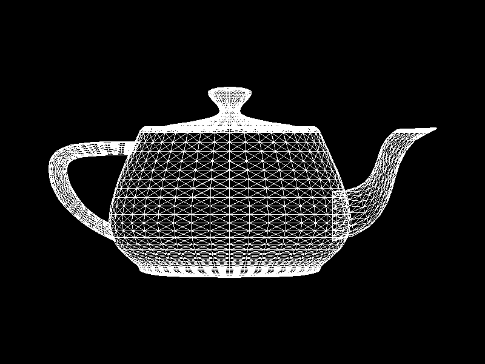
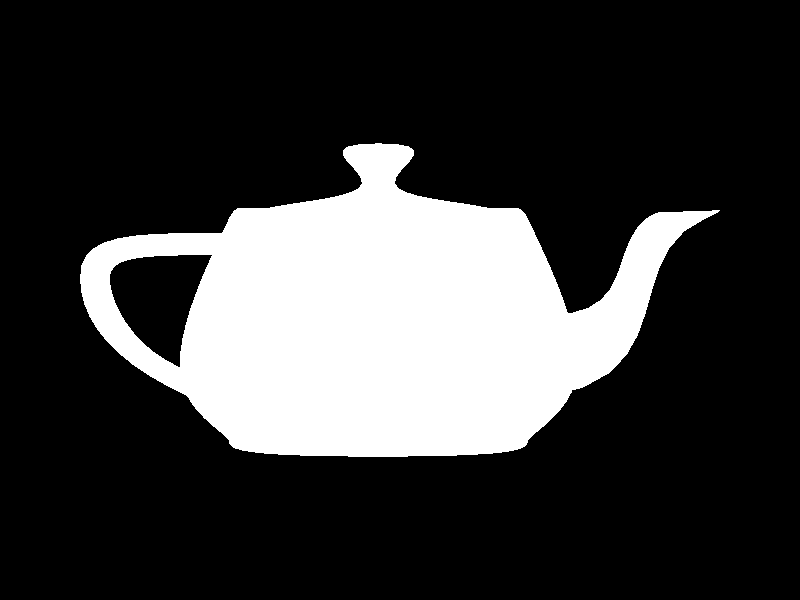
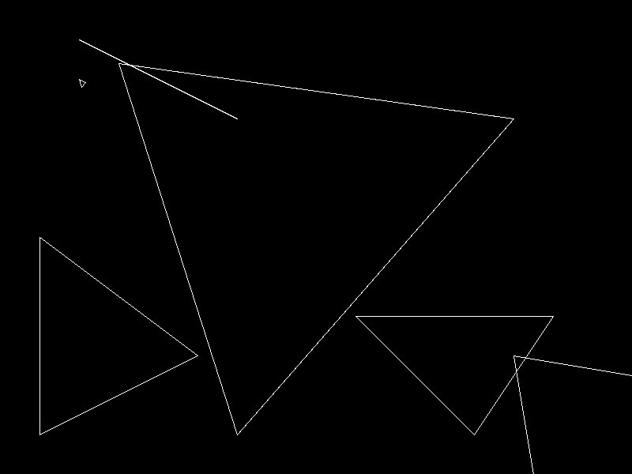
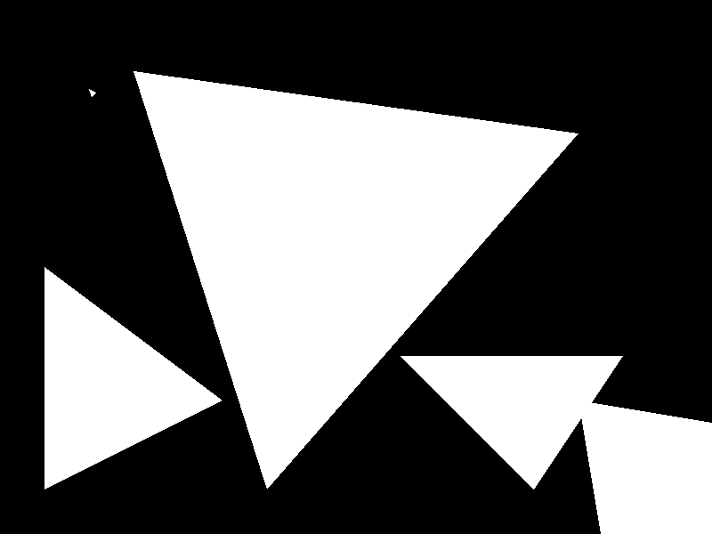
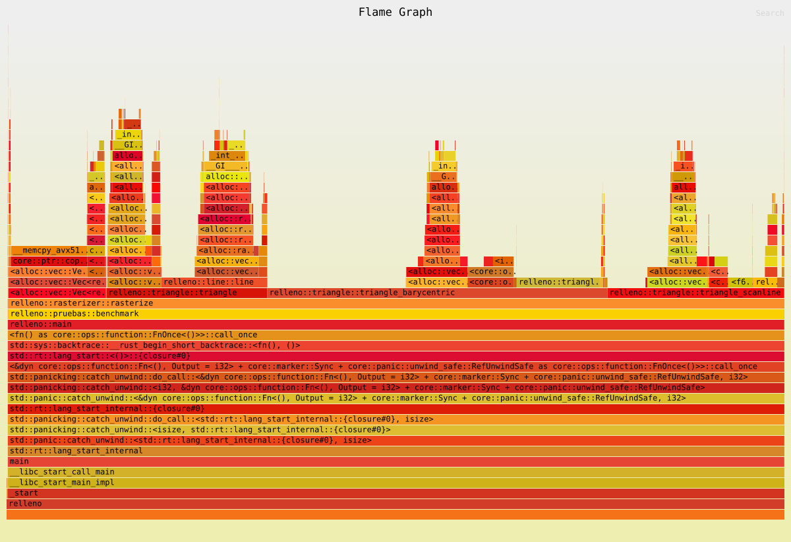

# Lab: Rellenar triángulos

En este lab la rasterización ya no solo genera el contorno de los triángulos: ahora también puede rellenarlos. Hice dos algoritmos de relleno (coordenadas baricéntricas y líneas horizontales), comprobé que generan exactamente los mismos fragmentos y comparé cuánto tarda cada uno.

Para probar uso la tetera (6320 triángulos) y los triángulos de prueba que pide el lab.

## Imágenes de cada modo

| Wireframe | Baricéntrico | Scanline |
|---|---|---|
|  |  |  |
|  |  |  |

Por ahora todos los fragmentos son blancos, así que la tetera rellena se ve como una silueta.

## Cómo correrlo

```
cargo run --release                              # ventana
cargo run --release -- --compare                 # compara los dos rellenos
cargo run --release -- --benchmark-triangles     # mediciones
cargo run --release -- --screenshot capturas     # guarda las imágenes de arriba
cargo flamegraph -- --benchmark-triangles        # perfil
```

En la ventana: 1 es wireframe, 2 baricéntrico, 3 scanline y T cambia entre la tetera y los triángulos de prueba. El modo actual aparece en el título de la ventana.

## El pipeline

`render` sigue las cuatro etapas:

1. **Procesamiento de vértices:** `vertex_shader` aplica la matriz de modelo de los uniforms a cada vértice.
2. **Ensamblaje de primitivas:** `primitive_assembly` agrupa los vértices de tres en tres.
3. **Rasterización:** `rasterize` genera los fragmentos de cada triángulo según el modo.
4. **Procesamiento de fragmentos:** `fragment_shader` devuelve el color y `framebuffer.point` lo escribe.

El cambio de este lab está en la rasterización. Ahora `rasterize` recibe también el modo:

```rust
#[derive(Clone, Copy)]
pub enum TriangleMode {
    Wireframe,
    FilledBarycentric,
    FilledScanline,
}

pub fn rasterize(triangles: &[[Vertex; 3]], mode: TriangleMode) -> Vec<Fragment>
```

Cada modo tiene su propia función, que recibe los tres vértices y devuelve un `Vec<Fragment>`:

- `triangle`: el wireframe de antes, con tres llamadas a `line`.
- `triangle_barycentric`: relleno con coordenadas baricéntricas.
- `triangle_scanline`: relleno con líneas horizontales.

Las demás etapas no cambian según el algoritmo.

La tetera usa una matriz de modelo que la escala y la mueve al centro de la ventana. La escala en `y` es negativa porque en pantalla `y` crece hacia abajo. Los triángulos de prueba ya están en coordenadas de pantalla, así que usan la matriz identidad.

## Los dos algoritmos

Los dos leen `transformed_position` de cada vértice, igual que `line`.

### Baricéntrico

1. Se calcula el rectángulo más pequeño que contiene al triángulo.
2. Se recorre cada píxel de ese rectángulo y se evalúa su centro `(x + 0.5, y + 0.5)`.
3. Para cada centro se calculan las tres coordenadas baricéntricas. Cada una es el área de un subtriángulo dividida entre el área del triángulo completo.
4. Si las tres son `>= 0`, el punto está dentro y se genera un fragmento.

Como se divide entre el área con signo, invertir el orden de los vértices cambia el signo de todo y el resultado es el mismo. Si el área es 0 (los tres vértices en una línea), la función regresa sin fragmentos antes de dividir.

### Scanline

Se avanza fila por fila. En cada fila se toma la línea horizontal que pasa por el centro de los píxeles (`y + 0.5`) y se calcula dónde la cruza cada arista. El cruce más a la izquierda y el más a la derecha forman el tramo, y se generan fragmentos para los píxeles cuyo centro está dentro de ese tramo.

Los casos especiales los resolví así:

- **Aristas horizontales:** no se puede calcular el cruce porque se dividiría entre 0. Si la arista está justo en la fila, se toma todo su tramo; si no, se ignora.
- **Vértice justo en una fila:** las dos aristas que llegan a él dan el mismo cruce. Como cada fila produce un solo tramo `[izquierda, derecha]`, no se generan fragmentos repetidos.
- **Triángulo degenerado:** se revisa el área igual que en el baricéntrico.

### La regla común

Para que los dos algoritmos se puedan comparar, usan la misma regla: un píxel genera un fragmento si su centro está dentro del triángulo o justo sobre un borde. Los cálculos los hice con `f64`. Primero probé con `f32` y en la tetera salió 1 píxel de diferencia: un centro quedaba casi exactamente sobre una arista y, por el redondeo, el scanline lo contaba y el baricéntrico no. Con `f64` esa diferencia desaparece.

## Comparación

Con `--compare` se corren los dos rellenos sobre los mismos triángulos y se comparan las posiciones de los fragmentos, no solo la imagen:

| Caso | Baricéntrico | Scanline | Diferencias | Duplicados (B / S) | Dentro de la ventana |
|---|---|---|---|---|---|
| Pequeño | 34 | 34 | 0 | 0 / 0 | 34 |
| Grande | 112255 | 112255 | 0 | 0 / 0 | 112255 |
| Borde horizontal | 18825 | 18825 | 0 | 0 / 0 | 18825 |
| Borde vertical | 25000 | 25000 | 0 | 0 / 0 | 25000 |
| Grande en orden inverso | 112255 | 112255 | 0 | 0 / 0 | 112255 |
| Parcialmente fuera | 43875 | 43875 | 0 | 0 / 0 | 18750 |
| Tres vértices en línea | 0 | 0 | 0 | 0 / 0 | 0 |
| Tetera (6320 triángulos) | 230846 | 230846 | 0 | 0 / 0 | 230846 |

Los dos generan exactamente las mismas posiciones en todos los casos, sin fragmentos repetidos. El triángulo en orden inverso da las mismas posiciones que en orden normal. No encontré diferencias en los bordes porque los dos usan la misma regla para los centros.

En el triángulo parcialmente fuera, la rasterización genera fragmentos para todo el triángulo (43875), pero solo 18750 caen dentro de la ventana. Los demás los descarta `framebuffer.point`, porque un fragmento todavía no es un píxel: si su posición queda fuera del framebuffer, no se dibuja.

El caso de tres vértices en línea sí aparece en wireframe (como una línea), porque ahí solo se dibujan los lados. En los rellenos no tiene interior, así que no genera nada.

## Mediciones

Con `cargo run --release -- --benchmark-triangles`. Los vértices se procesan y se ensamblan antes de medir, así que solo se mide `rasterize`, sin tocar la textura ni la ventana. Cada modo se ejecuta 100 veces por ronda, se hacen 7 rondas y se toma la mediana. Se usa `black_box` para que el compilador no se salte trabajo.

**Tetera (6320 triángulos pequeños)**

| Modo | Fragmentos | Mediana (100 ejecuciones) | Por ejecución |
|---|---|---|---|
| Wireframe | 227558 | 268.2 ms | 2.68 ms |
| Baricéntrico | 230846 | 362.5 ms | 3.63 ms |
| Scanline | 230846 | 224.3 ms | 2.24 ms |

**Triángulos de prueba (7 triángulos, algunos grandes)**

| Modo | Fragmentos | Mediana (100 ejecuciones) | Por ejecución |
|---|---|---|---|
| Wireframe | 5235 | 1.8 ms | 0.018 ms |
| Baricéntrico | 312244 | 193.3 ms | 1.93 ms |
| Scanline | 312244 | 90.4 ms | 0.90 ms |

Los dos rellenos producen la misma cantidad de fragmentos, así que la diferencia de tiempo no es porque uno haga menos trabajo útil.

## Perfil



Generado con `cargo flamegraph -- --benchmark-triangles` (el archivo es `flamegraph.svg`). Para que salgan los nombres de las funciones agregué `debug = true` en `[profile.release]`. Del total de muestras:

| Bloque | % de las muestras |
|---|---|
| `triangle_barycentric` | 43.7% |
| `triangle_scanline` | 22.7% |
| `triangle` (wireframe, incluye `line` con 13.6%) | 20.7% |
| Crecimiento del `Vec` (`grow_amortized`, incluye `realloc`) | 20.2% |
| `extend` (copiar los fragmentos de cada triángulo al `Vec` total) | 19.5% |
| `edge` (cálculo de las coordenadas) | 10.8% |

Algunos bloques se cruzan: el crecimiento del `Vec` aparece repartido dentro de las otras funciones, cada vez que un `push` o un `extend` se queda sin espacio.

## Qué encontré

- **El scanline es más rápido** aunque genera los mismos fragmentos. El baricéntrico revisa todos los píxeles del rectángulo, y en un triángulo cerca de la mitad de ese rectángulo queda afuera: son píxeles que se evalúan y se descartan. Además, por cada píxel calcula tres funciones de arista y tres divisiones. El scanline hace las cuentas una vez por fila y después solo agrega fragmentos seguidos.
- **La diferencia depende del tamaño.** Con los triángulos de prueba, que son grandes, el scanline fue unas 2.1 veces más rápido; con los triángulos pequeños de la tetera, unas 1.6 veces. En un triángulo pequeño se desperdician menos píxeles, y pesa más el trabajo fijo de cada triángulo.
- **El wireframe es casi igual de lento que el scanline** en la tetera, aunque genera casi la misma cantidad de fragmentos. Cada `line` crea su propio `Vec`, que después se copia en el de `triangle` y luego en el de `rasterize`. Son muchas reservas de memoria y copias.
- **Una buena parte del tiempo se va en manejar memoria y no en geometría.** Hacer crecer el `Vec` (`realloc` y `memcpy`) y copiar los fragmentos con `extend` pesan más que el cálculo de las coordenadas (`edge`). Una mejora sería reservar espacio desde el inicio con `Vec::with_capacity`, o que cada triángulo escriba directo en un solo `Vec` en vez de crear uno nuevo.
